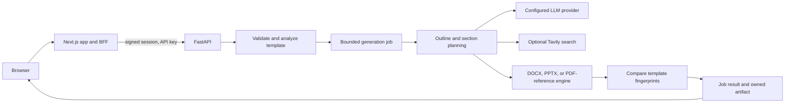

# Architecture

## Request flow

## Frontend and backend

- `src/app` contains the Next.js App Router UI and server routes. Browser requests use the BFF; backend URLs, API keys, and the session signing secret stay server-side.
- `backend/app/main.py` assembles the FastAPI API, security middleware, health endpoints, and routers.
- Upload analysis and document generation run in bounded worker pools. Generation is tracked by an in-process job manager; run one backend worker unless the job store is moved to shared infrastructure.
- The planner makes a structured outline, writes bounded sections, and checks each section for relevance, completeness, coherence, repetition, and unsupported claims. A failing section gets at most one targeted repair.
- Tavily search is opt-in. Retrieved source metadata is passed as untrusted evidence; citations must map to returned records. Search does not independently verify factual claims.

## Template handling

- DOCX and PPTX use the uploaded package as the structural base. The engines preserve supported styles and layout structures, then the validator compares canonicalized package components.
- A failed validation is surfaced as a failure and disables the normal download action.
- PDF files are reference inputs. Output is a newly generated DOCX using extracted page geometry and visible header/footer text; it is not a PDF template-preserving edit.
- Requested page counts and Low/Medium/High detail levels estimate content volume. Rendered pagination varies by template and office software. PPTX uses a slide target.

## Operational boundaries

- The Compose backend is private to the Compose network. The frontend is published on loopback for a reverse proxy.
- Local job state and ownership metadata are stored on disk. Jobs and artifacts are removed according to the configured retention period.
- Inline PDF/PNG previews are not implemented in this build; health reports `capabilities.preview: false`, and the result view directs users to download the artifact.
- Live model, Tavily, Word, PowerPoint, Docker, and deployment behavior require the operator checks in `MANUAL_QA.md`; mocked or structural tests do not establish those external results.
